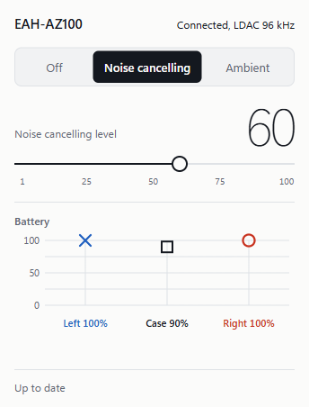
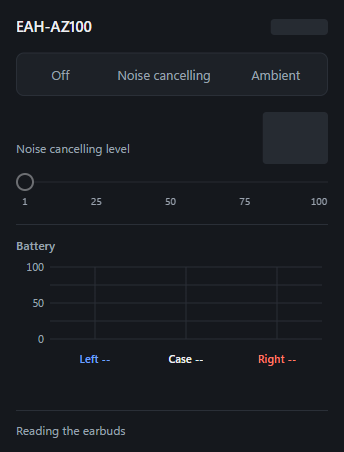

# technics-az100

Control **Technics EAH-AZ100** earbuds from Windows: noise cancelling, ambient sound and their levels, from the tray or the command line.

Technics Audio Connect only exists for iOS and Android, so on a PC these settings are normally out of reach. This project talks to the
earbuds over their own Bluetooth control channel (Airoha RACE over RFCOMM), the same one the phone app uses.

<p>
  
  
</p>

> Unofficial. Not affiliated with, endorsed by or supported by Panasonic or Technics. "Technics" is a trademark of Panasonic Holdings
> Corporation. Use at your own risk.

## What it can do

- Switch between **Off**, **Noise cancelling** and **Ambient**, and set each level (1 to 100)
- **Auto level** (adaptive noise cancelling) and the ambient sub-mode (**Transparent** / **Attention**)
- Live stream mode (**Auto**, suppress interruptions, or reduce delay)
- Read the battery level of each earbud and the case, plus the codec in use (LDAC / AAC / SBC and sample rate)
- Global hotkey **Ctrl+Alt+E** to cycle Off → Noise cancelling → Ambient
- Optional **Movie mode**, for the [Alternative A2DP Driver](https://www.bluetoothgoodies.com/a2dp/) only: one switch from LDAC to SBC with "reduce delay" for lower latency, and back

## Safety

The earbuds accept commands that factory-reset them, wipe all pairings or flash firmware. The tool is built so that it cannot send those:

- The only commands it can send are on a short allowlist (see the top of [`tool/technics.py`](tool/technics.py)). It has no raw-command passthrough.
- Before sending anything it reads the model ID, and it stops if the earbuds are not an AZ100.
- One command at a time, writes at least 0.5 s apart, every write read back and verified, and never retried silently.
- The command line writes nothing unless you pass `--yes`. Before its first mode or level change it saves the earbuds' state to `tool/baseline.json`, and `restore --yes` puts it back.

Tested on one AZ100E (firmware JNZ1ZE 1.040) with Windows 11. Other AZ100 variants (model IDs 0xA0 to 0xA3) are accepted but have not been tested.

## Requirements

- Windows 11 (Windows 10 is untested) with the earbuds paired and connected to the PC
- Python 3.12 or later
- For the tray app: the Microsoft Edge WebView2 runtime (included with Windows 11)
- Close the Technics app on your phone while using this, because only one controller can hold the control channel

## Tray app

```
pip install -r tray/requirements.txt
tray\start.cmd
```

Left-click the tray icon to open the flyout. Right-click it for **Start with Windows** and **Quit**. To try the UI without earbuds, run
`python tray/app.py --demo --show`.

The hotkey is set in `tray/settings.json`, which is created on first run.

## Command line

```
python tool/technics.py status                  # model, mode and levels, connection option, codec (read-only)
python tool/technics.py anc 60 --yes            # noise cancelling at level 60
python tool/technics.py ambient 70 --yes        # ambient sound at level 70
python tool/technics.py off --yes               # both off (levels kept)
python tool/technics.py adaptive on --yes
python tool/technics.py ambient-mode attention --yes
python tool/technics.py buffer-mode video --yes # auto | music | video
python tool/technics.py restore --yes           # back to the saved baseline
python tool/technics.py selftest                # offline tests, no earbuds needed
```

Without `--yes`, a write command shows what it would send and stops.

## Finding the earbuds

The earbuds are found automatically: the tool looks for a paired Bluetooth device whose name contains `EAH-AZ100`. If none or more than
one is found, give the address with `--addr XX:XX:XX:XX:XX:XX` or the `TECHNICS_ADDR` environment variable. Windows shows the address
under Device Manager → Bluetooth → the earbuds → Properties → Details → Bluetooth device address.

## Movie mode (optional)

Movie mode only applies if you use the paid Alternative A2DP Driver for LDAC. The driver's settings can only be changed by an
administrator, so a one-time setup installs a small helper that is allowed to do exactly two things: switch to the movie profile, and
switch back to your saved music settings. Run it from an elevated PowerShell:

```
powershell -ExecutionPolicy Bypass -File tray\admin\setup_movie_helper.ps1             # or add -Address XX:XX:XX:XX:XX:XX
```

The setup installs the helper in `C:\Program Files\TechnicsAZ100Tool`, where only administrators can change it, and first backs up
the driver's settings for your earbuds to its `data` folder. To undo it, run
`tray\admin\remove_movie_helper.ps1`. If you never run the setup, the Movie mode switch stays hidden.

## How it works

[`docs/PROTOCOL.md`](docs/PROTOCOL.md) is the protocol research log: frame format, command IDs, and which commands are dangerous. It came from static
analysis of the Android app, an HCI capture of the app, and live tests. [`docs/DESIGN.md`](docs/DESIGN.md) describes the tray UI.
No code or assets from the official app are included here.

## How it was built

- **Found the protocol.** Static analysis of the Android app showed it runs on an Airoha chipset and talks to the earbuds with
  Airoha's RACE command protocol over a Bluetooth serial channel (RFCOMM). I mapped the frame format and the command IDs for each setting.
- **Sorted safe commands from dangerous ones.** One command that looked like a harmless connect handshake turned out to be
  **factory reset**. A separate review pass caught it. After that, the tool was built around a short allowlist with no way to send raw bytes.
- **Checked against the real traffic.** I captured the official app's Bluetooth traffic on an Android phone and decoded it. Frames,
  IDs and replies matched the notes byte for byte.
- **Tested on hardware, one step at a time.** Read-only first, then a write of the value already set, then real changes, each read back
  and verified. That came to about 25 writes with no errors. A fake-earbud simulator runs the same checks offline (`selftest`).
- **Fixed what live use exposed.** Windows' clock ticks about every 15 ms, which made every read wait a full 250 ms timeout.
  A race let the UI show a state the earbuds weren't in. The hotkey could hold the control channel open forever.
- **Hardened the elevated part.** The Movie mode helper runs only as two fixed scheduled tasks that take no input. A security review
  then moved its data to a folder only administrators can write.
- **Built with AI assistance.** I directed the research, set the safety rules, ran the hardware tests and made the calls, working
  with Claude Code as a pair programmer.

### Tools

| Area | Tools |
|---|---|
| Static analysis | [JADX](https://github.com/skylot/jadx) on OpenJDK 21 |
| Traffic capture | Android Bluetooth HCI snoop log, Wireshark / tshark |
| Screen-recording review | FFmpeg (frame sheets lined up with the capture timeline) |
| Bluetooth on Windows | Python `ctypes` over Winsock (SDP lookup, RFCOMM sockets) and `bthprops` |
| Tray app | Python, [pystray](https://github.com/moses-palmer/pystray), [pywebview](https://pywebview.flowrl.com/) (Edge WebView2), Pillow, HTML/CSS/JS |
| UI testing | Playwright (light/dark, states, interaction) |
| Movie mode | PowerShell, Windows Task Scheduler, [Alternative A2DP Driver](https://www.bluetoothgoodies.com/a2dp/) |
| Development | Claude Code; Impeccable for UI design direction and review |

## Legal

- This is an independent project, made so that earbuds you own can work with Windows. It is not affiliated with, endorsed by or
  supported by Panasonic, Technics or Airoha. Product names are used only to say what the tool works with.
- The repository contains only original code and notes. It includes no code, binaries, firmware, images or other assets from the
  official app or the earbuds. The protocol was worked out from the app's behaviour for interoperability. No encryption, copy
  protection or access control was bypassed; the earbuds' control channel has none.
- Using third-party software with your earbuds may affect your warranty. The software comes with no warranty (see the license), and
  you use it at your own risk.
- If you represent a rights holder and have a concern, please open an issue.

## License

[MIT](LICENSE)
